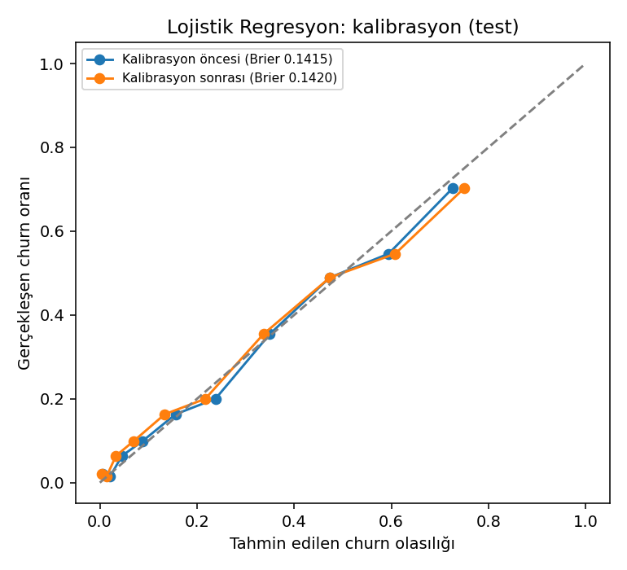
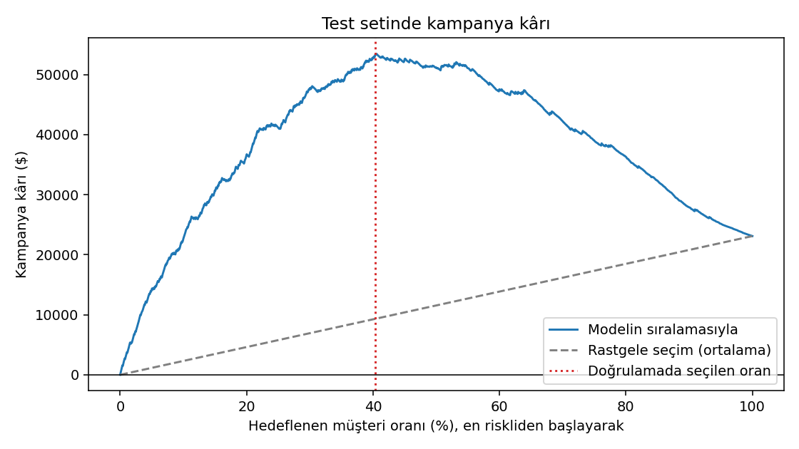
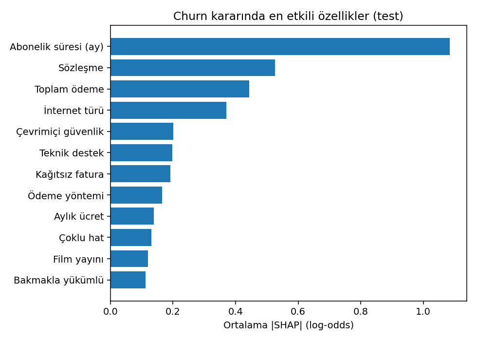
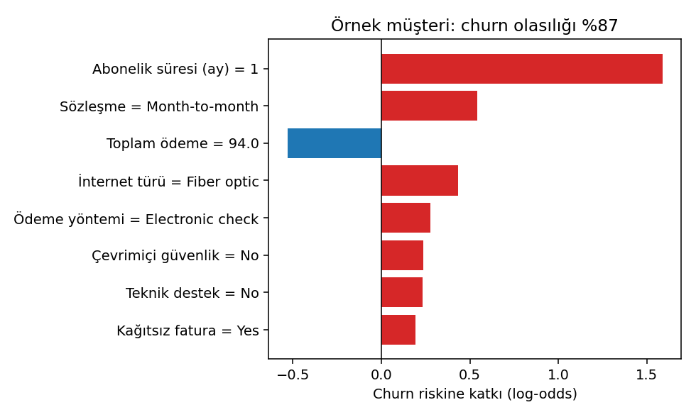

# Müşteri Kaybı (Churn) Tahmini ve Kampanya Hedefleme

Bir telekom şirketinde hangi müşterilerin ayrılacağını tahmin eden ve asıl soruyu cevaplayan bir sistem:
**elde tutma kampanyasını kime yapalım ki kâr en yüksek olsun?**

Churn modelleri genelde doğrulukla değerlendiriliyor, ama şirket için önemli olan para. Herkese kampanya yapmak
pahalı (zaten kalacak müşterilere de indirim veriliyor), kimseye yapmamak da müşteri kaybettiriyor. Bu projede
modelin olasılıklarını müşteri başına beklenen kâra çevirip kampanya stratejilerini karşılaştırdım.

- 4 model karşılaştırması (lojistik regresyon, Random Forest, XGBoost, LightGBM)
- Olasılık kalibrasyonu kontrolü (kâr hesabı olasılığın kendisine dayandığı için)
- Kampanya kâr modeli ve strateji karşılaştırması, varsayımlara duyarlılık analizi
- SHAP ile müşteri bazında "neden riskli" açıklaması
- FastAPI servisi (tek müşteri ve toplu kampanya listesi), testler, Dockerfile

## Veri

[IBM Telco Customer Churn](https://github.com/IBM/telco-customer-churn-on-icp4d): 7.043 müşteri, %26,5'i ayrılmış.
Demografi, abonelik süresi, sözleşme türü, internet ve ek hizmetler, ödeme yöntemi, aylık ve toplam ücret.
%60 eğitim / %20 doğrulama / %20 test, churn oranı her bölümde aynı. Model seçimi, kalibrasyon ve hedeflenecek
müşteri oranı doğrulama setinde; aşağıdaki sonuçlar test setinde (1.409 müşteri, 374'ü ayrılmış).

## Sonuçlar

### Model karşılaştırması

| Model | Doğrulama ROC-AUC | Doğrulama PR-AUC | Test ROC-AUC |
| --- | --- | --- | --- |
| **Lojistik Regresyon** (seçilen) | **0,860** | 0,678 | **0,832** |
| XGBoost | 0,858 | 0,680 | 0,832 |
| Random Forest | 0,857 | 0,672 | 0,832 |
| LightGBM | 0,850 | 0,671 | 0,820 |

Ağaç modelleri lojistik regresyonu geçemedi. Veri küçük ve ilişkiler büyük ölçüde doğrusal (sözleşme türü,
abonelik süresi); bu durumda basit ve yorumlanabilir model tercih edilir.

### Kalibrasyon

Kâr hesabı "bu müşteri %40 ihtimalle ayrılacak" gibi olasılıkları doğrudan kullandığı için olasılıkların gerçekçi
olması gerekiyor. Doğrulama setinde sigmoid kalibrasyonu denedim; lojistik regresyon zaten iyi kalibre olduğu için
fark etmedi (test Brier skoru 0,1415 → 0,1420).



### Kampanya kârı

Varsayımlar (`src/kampanya.py`):
- Hedeflenen müşteriye 1 aylık ücretsiz kullanım teklif ediliyor, ayrıca kişi başı 5 $ iletişim maliyeti var.
- Ayrılacak bir müşteri teklifle %30 ihtimalle kalıyor; kalırsa 12 aylık geliri korunuyor.
- Zaten kalacak bir müşteri de teklifi kabul ediyor, yani hediye edilen ay boşa gidiyor.

Test setinde (1.409 müşteri):

| Strateji | Kâr |
| --- | --- |
| Kimseye kampanya yapma | 0 $ |
| Herkese kampanya | 23.106 $ |
| Rastgele 569 müşteri | 9.468 $ |
| **Model: en riskli %40 (569 müşteri)** | **53.400 $** |
| Model: beklenen kârı pozitif olanlar (579 müşteri) | 52.788 $ |

Model, müşterilerin yalnızca %40'ına ulaşarak herkese kampanya yapmanın **2,3 katı** kâr getiriyor.
Hedeflenecek oran (%40) doğrulama setinde seçildi, testte aynısı uygulandı.



İkna oranı varsayımı değişirse (müşteri başına beklenen kâr > 0 kuralıyla):

| İkna oranı | Model kaç kişiyi hedefliyor | Model kârı | Herkese kampanya kârı |
| --- | --- | --- | --- |
| %10 | 309 | 6.386 $ | -38.855 $ |
| %20 | 494 | 26.060 $ | -7.874 $ |
| %30 | 579 | 52.788 $ | 23.106 $ |
| %50 | 696 | 105.586 $ | 85.068 $ |

Kampanya ne kadar az etkiliyse modelle hedeflemek o kadar önemli hale geliyor: ikna oranı %10-20 iken herkese
kampanya zarar ettiriyor, model ise hâlâ kâr ediyor.

### Kim neden ayrılıyor? (SHAP)



En etkili özellikler abonelik süresi, sözleşme türü, toplam ödeme, internet türü ve çevrimiçi güvenlik hizmeti.
Yeni, aylık sözleşmeli, fiber internetli ve elektronik çekle ödeyen müşteriler en riskli grup; ek güvenlik ve teknik
destek hizmeti alanlar daha sadık.



## API

```bash
uvicorn api.app:app      # http://127.0.0.1:8000/docs
```

| Uç nokta | Açıklama |
| --- | --- |
| `GET /saglik` | Servis durumu |
| `POST /musteri` | Tek müşteri: churn olasılığı, risk seviyesi, kampanya önerisi, nedenler |
| `POST /kampanya` | Müşteri listesi: kimlere kampanya yapılmalı, toplam beklenen kâr |

Örnek cevap:

```json
{"churn_olasiligi": 0.8717, "risk": "yüksek", "kampanya_onerisi": true, "beklenen_kampanya_kari": 253.34,
 "nedenler": [{"ozellik": "Abonelik süresi (ay)", "deger": "1", "etki": 1.537},
              {"ozellik": "İnternet türü", "deger": "Fiber optic", "etki": 0.407},
              {"ozellik": "Sözleşme", "deger": "Month-to-month", "etki": 0.346}]}
```

Docker ile:

```bash
docker build -t churn-api .
docker run -p 8000:8000 churn-api
```

## Çalıştırma

```bash
python -m venv .venv
.venv\Scripts\activate          # Linux/macOS: source .venv/bin/activate
pip install -r requirements.txt
```

`Telco-Customer-Churn.csv` dosyasını [IBM'in deposundan](https://github.com/IBM/telco-customer-churn-on-icp4d/tree/master/data)
indirip `data/` altına koyun.

```bash
python -m src.egit        # modeller, kalibrasyon, kampanya sonuçları
python -m src.acikla      # SHAP grafikleri
python -m src.cikarim     # API için SHAP arka plan örneklemi
pytest
```

## Klasör yapısı

```
src/
  veri.py        veri okuma, özellikler, bölme
  modeller.py    karşılaştırılan modeller (ön işleme dahil pipeline)
  kampanya.py    kampanya kâr modeli
  egit.py        eğitim, kalibrasyon, strateji karşılaştırması
  acikla.py      SHAP; one-hot sütunları asıl özellik altında toplanıyor
  cikarim.py     müşteri puanlama (API için)
api/app.py       FastAPI servisi
tests/           API testleri
models/          kalibre edilmiş model, SHAP arka planı
reports/         sonuçlar ve grafikler
```

## Sınırlamalar

- Kampanyanın etkisi (ikna oranı) varsayım; gerçekte bir A/B testiyle ölçülmesi gerekir. Daha da iyisi, kampanyanın
  kimde işe yaradığını doğrudan tahmin eden bir uplift modeli; bunun için kampanya geçmişi verisi lazım.
- Gelir olarak 12 aylık ücreti kullandım; gerçek müşteri yaşam boyu değeri (kâr marjı, beklenen süre) daha doğru olur.
- Veri tek bir zaman kesiti; ayrılma zamanı bilinmediği için "ne zaman ayrılacak" sorusu (sağkalım analizi) cevaplanamıyor.

## Yazar

Batın Dikilitaş, Kocaeli Üniversitesi Yapay Zeka ve Makine Öğrenmesi
